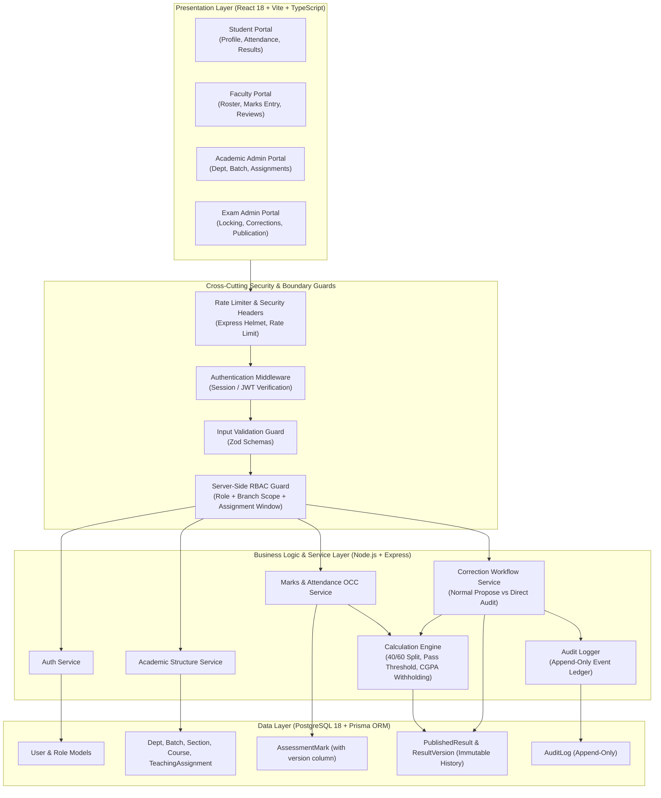

# Round 1 Design Specification — College ERP & Academic Core

## 1. System Overview & Technology Stack Confirmation

This document presents the architectural design, security model, data consistency guarantees, and calculation engine for the single-institution Engineering College ERP. 

### Stack Confirmation & Runtime Audit
* **Operating System & Runtime:** Linux x86_64 (Ubuntu 26.04 LTS), Node.js v20.18.0, npm 10.8.2.
* **Database:** PostgreSQL 18.6 running locally on port 5432, database `college_erp`.
* **ORM:** Prisma Client with version-controlled SQL migrations.
* **Backend:** Express.js + TypeScript with modular monolith architecture.
* **Frontend:** React 18 + TypeScript + Vite + Tailwind CSS.
* **Validation:** Zod v3 for strict type inference and runtime boundary checking.
* **Testing:** Vitest + Supertest for automated unit, RBAC security, concurrency, and end-to-end scenario verification.

---

## 2. Primary Depth Focus: Academic Data Integrity & Safe Concurrency

Academic records (marks, attendance, results, transcripts) are authoritative institutional assets. The core vulnerability in academic ERPs is silent data corruption resulting from concurrent faculty evaluations, untracked grade modifications, or client-side trust.

Our primary depth focus addresses:
1. **Zero Client Trust:** All authorization decisions, boundary checks, component weightings, pass/fail derivations, and audit trails occur strictly within the backend service layer.
2. **Version-Based Concurrency Control:** Every mutable academic entity (such as student assessment marks and draft results) carries an integer `version` field. Concurrent submissions comparing stale versions trigger explicit `409 Conflict` errors to prevent lost updates.
3. **Immutable Result History:** Published results are never updated in place. Any authorized correction creates a cryptographically auditable, versioned record preserving previous scores, actor attribution, correction category, and evidence reference.

---

## 3. Consistency Model & Concurrency Architecture

### Optimistic Concurrency Control (OCC)
* Every assessment mark and grade draft record includes:
  * `id`: UUID primary key
  * `version`: integer incremented atomically on every mutation (`UPDATE ... SET version = version + 1 WHERE id = $id AND version = $expectedVersion`)
  * `updatedAt`: ISO timestamp
* **Conflict Detection & Response:**
  * When a faculty or exam administrator submits an edit, the payload must include `expectedVersion`.
  * If the record in the database has a `version != expectedVersion`, the transaction immediately aborts and returns:
    ```json
    {
      "status": 409,
      "code": "CONCURRENT_MODIFICATION_CONFLICT",
      "message": "Record was modified by another session. Please reload latest data and review changes before resubmitting.",
      "currentVersion": 2,
      "staleVersion": 1
    }
    ```
* **Client Reload & Retry Flow:**
  * The frontend detects `409 Conflict`, halts further saves, displays a non-destructive side-by-side diff notification, fetches the latest record state from `/api/...`, and requires user confirmation before submitting with the updated `expectedVersion`.

---

## 4. Multi-Scoped Server-Side RBAC Architecture

Frontend route guarding or button hiding is strictly a presentation enhancement and **never** a security boundary. The backend implements a deny-by-default interceptor with deep hierarchical validation:

```
[Incoming Request]
       │
       ▼
[1. Authentication Layer] (Verify JWT / Session Token, populate req.user)
       │
       ▼
[2. Global Role Gate] (Check user.role IN allowedRoles)
       │
       ▼
[3. Scoped Authority Gate]
   ├── Student: Can ONLY access records where record.studentId == req.user.id
   ├── Faculty: Must hold active, effective-dated TeachingAssignment for offeringId
   │            (assignment.startDate <= today <= assignment.endDate)
   ├── Academic Admin: Scoped to institutional structure; FORBIDDEN from marks/results
   └── Exam Admin: MUST be the designated active Exam Admin for the offering's branch
       │
       ▼
[4. Workflow State Gate] (Verify target record status: e.g. DRAFT, LOCKED, PUBLISHED)
       │
       ▼
[5. Business Operation Execution] (In atomic DB Transaction)
```

### Roles and Boundaries:
* **Student:** View own profile, enrolled courses, attendance, published results. Can submit internal correction requests. Blocked from other students' records (returns masked 404 or 403), administrative routes, and marks modification.
* **Faculty:** Scoped strictly to assigned course offerings during effective date windows. Can enter attendance and internal marks while unlocked. Can propose corrections. Cannot modify external marks or directly overwrite published results.
* **Academic Admin:** Manages departments, batches, sections, courses, student/faculty accounts, and effective-dated teaching assignments. Blocked from entering or altering marks and published results. Cannot grant self Exam Admin status.
* **Examination Admin:** Designated strictly per branch (`branchId`). Only the designated Exam Admin for CSE can manage CSE assessments, verify/lock internals, publish CSE results, and execute eligible direct corrections. Blocked from modifying teaching assignments or operating on other branches.

---

## 5. College-Specific Academic & Calculation Policy

### Department & Cohort Hierarchy
* **Departments (Branches):** `CSE`, `Civil`, `Chemical`, `EEE` (extensible by Academic Admin).
* **Batches:** `2024–2028`, `2025–2029`, `2026–2030`.
* **Sections:** `A`, `B`, `C`, `D` per batch/department.

### Assessment Mark Structure
* **Theory & Laboratory Maximums:**
  * Internal Assessment Maximum: **40 marks**
  * External Assessment Maximum: **60 marks**
  * Combined Maximum: **100 marks**
* **Internal Component Configuration:**
  * Admin-configurable sub-components (e.g., Mid-1 [15], Mid-2 [15], Quizzes/Assignments [10] = 40 total). Server validates `Σ component_max == 40`.
  * External end-semester exam max is fixed at 60.

### Calculation & Grade Rules (Demo Policy)
* **Passing Thresholds:**
  * Internal minimum pass: 40% (16 / 40)
  * External minimum pass: 40% (24 / 60)
  * Total minimum pass: 40% (40 / 100)
  * If a student scores < 16 internal OR < 24 external, status is `FAILED` regardless of aggregate.
* **Absence Handling:** Marked as `AB`. Grade points = 0. Treated as incomplete/failed.
* **Grade Bands (10-point scale):**
  * 90 – 100: **O** (10 GP) — Outstanding
  * 80 – 89:  **A+** (9 GP) — Excellent
  * 70 – 79:  **A** (8 GP) — Very Good
  * 60 – 69:  **B+** (7 GP) — Good
  * 55 – 59:  **B** (6 GP) — Above Average
  * 50 – 54:  **C** (5 GP) — Average
  * 40 – 49:  **P** (4 GP) — Pass
  * < 40:     **F** (0 GP) — Fail
* **SGPA Calculation:** $\text{SGPA} = \frac{\sum (\text{Course Credits} \times \text{Grade Points})}{\sum \text{Course Credits}}$ (rounded to 2 decimal places).

### The CGPA Availability Rule
* Official CGPA is computed and displayed **only if** the student has passed every required course in the enrolled curriculum up to the current semester.
* If any required course is `F` (Failed), `AB` (Absent), or missing:
  * Official CGPA is **withheld**.
  * System outputs status: `"CGPA withheld — required subject(s) not passed"`.
  * Prior published CGPA records remain archived in history with immutable version tags.

---

## 6. Published Result Correction Pathways

### 6.1 Normal Academic Pathway
1. Student submits correction request with reason.
2. Assigned Faculty reviews, verifies evidence, and either rejects or proposes a revised mark with detailed justification.
3. Designated Examination Admin inspects the proposal, verifies branch scope, and authorizes publication of a new result version.

### 6.2 Privileged Direct Examination Admin Pathway
* **Strict Eligibility Gate:** Permitted only for verifiable, objective administrative errors:
  1. `TRANSCRIPTION_ERROR`: Data entry typographical mistake differing from signed physical sheet.
  2. `IMPORT_MAPPING_ERROR`: Mark misassigned to incorrect student ID or column during bulk import.
  3. `APPROVED_CALCULATION_CORRECTION`: Confirmed configuration/script defect in derived aggregation.
* **Preconditions & Mandatory Inputs:**
  * Must be designated Exam Admin for that specific branch.
  * Mandatory authoritative evidence reference (e.g., `DOC-OMR-BATCH24-CSE-0982`).
  * Detailed audit reason.
  * Corrected source marks (internal or external).
* **Execution:**
  * Recalculates total, grade, SGPA, CGPA eligibility server-side.
  * Atomically in one transaction:
    * Archives version $N$ as superseded.
    * Writes version $N+1$ with updated marks and publication status.
    * Appends immutable audit log entry detailing previous vs new values, actor, category, reason, and evidence token.

---

## 7. Layered Architecture Diagram



---

## 8. Round 2 Acceptance Scenarios Verification Plan

| Scenario | Objective | Input / Action | Expected HTTP & System Result | Persisted Database Evidence |
| :--- | :--- | :--- | :--- | :--- |
| **A. Concurrent Faculty Edits** | Prevent lost updates under simultaneous edits | Faculty A submits `version: 1` update; Faculty B simultaneously submits stale `version: 1` | Faculty A receives `200 OK`; Faculty B receives `409 Conflict`. Record advances to version 2. | Single persistent record with version 2 containing Faculty A's value. Zero overwrites. |
| **B. Student Attacks Faculty API** | Verify server-side authorization boundaries | Authenticated Student invokes `PUT /api/marks/:id`, `POST /api/academic/assignments`, and `GET /api/results/student/:otherId` | HTTP `403 Forbidden` (or masked `404 Not Found`). Request rejected before service logic. | Zero database modifications; security audit event logged. |
| **C. Result Correction (Normal & Direct)** | Verify both ordinary review and privileged evidence-backed correction | 1) Student request -> Faculty proposal -> Exam Admin approve.<br/>2) Direct Exam Admin correction with category `TRANSCRIPTION_ERROR` & evidence token. | `200 OK`. Result version increments to $N+1$. Recalculates grades & CGPA. Stale versions and non-branch admins rejected with `409` and `403`. | `ResultVersion` table retains immutable old version. `AuditLog` captures actor, old/new marks, reason, and evidence token. |
| **D. Mid-Semester Reassignment** | Verify historical attribution and forward-dated scope transfer | Academic Admin sets Faculty A's assignment end date and assigns Faculty B effective from date $T$. | Historical marks retain Faculty A's ID; Faculty B can record new marks; Faculty A editing after $T$ is rejected with `403`. | `TeachingAssignment` table contains both dated assignments; historical `AssessmentMark` retains Faculty A reference. |
